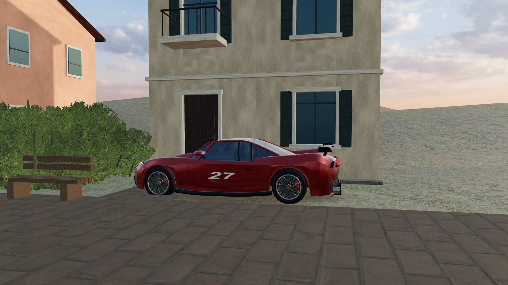

# Verificação da Costa Dourada

**Os testes automatizados executados passaram.**

A medição de desempenho cobre a GPU identificada na tabela. As diferenças visuais mais evidentes nas capturas são a espuma rasa na praia, os acostamentos claros do bosque e a repetição de algumas fachadas. Cada comparação está documentada ao lado da imagem.

## Corridas e integridade

| Voltas | Tempo de corrida | Ultrapassagens entre IAs | Resets de integridade | Intrusões da câmera | Maior afastamento de roda |
|---:|---:|---:|---:|---:|---:|
| 3 | 317,04 s | 13 | 0 | 0 | 0,110 m |
| 6 | 630,32 s | 13 | 0 | 0 | 0,110 m |

Os percursos de 3 e 6 voltas usam o passo de física de 1/120 s pelo fluxo normal da interface. O verificador acelera o relógio de simulação nessas jornadas. A volta gravada é outro percurso, em tempo real. O teste de corte começou na linha, saltou um setor e tentou fechar a volta com o próximo checkpoint pendente. Contagem concedida de 0 voltas.

Depois dos três reinícios, a contagem de fontes contínuas foi 21, 21, 21, a partir de 21. Heap do JavaScript após coleta explícita, em MiB, de 23,1 → 23,4 → 23,5 → 23,5. [Registro das duas jornadas](race-tests.json).

## Cena

O circuito mede 2969,25 m. O grafo carregado contém 92 unidades arquitetônicas em 8 variações. As janelas completas da vila têm 16, 15, 15, 16, 14 frentes, em sequência. O Vela GT usa 124.606 triângulos no LOD0. O Bruma RS usa 124.606 triângulos no LOD0. [Instâncias, projeções e cotas por janela](scene-stats.json).

## Áudio e vídeo

O WAV contém 106,01 s de PCM estéreo a 48000 Hz. A medição independente sobre as amostras gravadas encontrou pico de **-2,98 dBFS** e RMS de -11,16 dBFS. O grafo chegou a 24 fontes simultâneas, incluindo fontes contínuas em crossfade e disparos transitórios. Máximo de motores posicionais audíveis das IAs de 5.

| Evento no áudio | Instante (mm:ss,cc) |
|---|---:|
| Troca de marcha | 00:00,04 |
| Contato com outro carro | 00:01,02 |
| Derrapagem | 00:01,94 |
| Passagem por uma IA | 00:04,15 |
| Entrada na ponte | 01:22,95 |

O navegador gravou diretamente a saída após o limitador. O contêiner do vídeo contém V_VP9 (105,94 s e 3172 pacotes) e A_OPUS (105,90 s e 1766 pacotes). [Volta em vídeo](volta.webm) · [PCM do master](audio-volta.wav) · [Eventos temporizados](audio-metrics.json).

## Desempenho

GPU ANGLE (NVIDIA, NVIDIA GeForce RTX 3070 Ti (0x00002482) Direct3D11 vs_5_0 ps_5_0, D3D11). CPU AMD Ryzen 7 5700G with Radeon Graphics. Chromium 150.0.7871.127 em Windows_NT 10.0.26300. Resolução de saída 1920×1080. Chromium headless, rAF sem limite de VSync, seis carros simulados na vila.

| Preset | FPS médio | 1% low | Frames |
|---|---:|---:|---:|
| Alta | 82,8 | 62,1 | 180 |
| Baixa | 76,5 | 62,7 | 180 |

A RTX 3060 e uma GPU integrada continuam sem ensaio direto nesta execução. [Tempos individuais de frame](performance.json).

## Imagens de 1920 × 1080

As comparações usam painéis de iguais dimensões. S9 e S11 incluem ampliações da própria captura, S10 tem a vista em Alta e S12 tem a projeção da spline original. As referências comerciais só entram nas comparações. O céu é medido ocultando a cúpula, contando os pixels de fundo que permanecem livres e descontando a opacidade do HUD. A luminância usa Rec. 709 sobre RGB de exibição normalizado. O histograma usa 4 bits por canal.

| Captura | FPS | Céu | Luminância | Desvio | Maior bucket |
|---|---:|---:|---:|---:|---:|
| [S1](s1-reta-orla.png) | 100,0 | 35,4% | 0,573 | 0,266 | 6,7% |
| [S2](s2-grid-3-4.png) | estática | 11,0% | 0,355 | 0,215 | 8,8% |
| [S3](s3-praia-espuma.png) | 100,0 | 36,0% | 0,578 | 0,265 | 3,7% |
| [S4](s4-falesia-mirante.png) | 100,0 | 11,4% | 0,364 | 0,217 | 9,5% |
| [S5](s5-vila-rua.png) | 96,2 | 26,0% | 0,496 | 0,225 | 8,4% |
| [S6](s6-bosque-luz.png) | 100,0 | 34,3% | 0,546 | 0,261 | 6,4% |
| [S7](s7-ponte-ou-tunel.png) | 100,0 | 33,1% | 0,559 | 0,197 | 4,7% |
| [S8](s8-disputa.png) | 100,0 | 34,4% | 0,498 | 0,238 | 10,6% |
| [S9](s9-close-pista.png) | 100,0 | 38,0% | 0,483 | 0,258 | 13,0% |
| [S10](s10-baixa-vila.png) | 100,0 | 26,0% | 0,491 | 0,227 | 8,3% |
| [S11](s11-escala.png) | estática | 13,2% | 0,427 | 0,211 | 9,8% |
| [S12](s12-mapa.png) | estática | n/a | — | — | n/a |

### Diferenças observadas

- **S1** — O enquadramento de perseguição deixa mais asfalto entre a câmera e o pelotão do que a referência 01. As palmeiras têm copas mais compactas, a luz de contorno no carro é mais estreita e os promontórios têm menos estratos de rocha do que na 02. [Comparação](compare/s1.png).
- **S2** — O cupê vermelho aparece de frente e pela esquerda, com o conjunto roda, disco e pinça exposto. Na referência 11, o aerofólio traseiro ocupa muito mais do quadro. O vidro reflete uma faixa mais uniforme de céu e a pintura tem um reflexo frontal mais concentrado. O galpão da referência produz sombras recortadas que o grid ao ar livre não reproduz. [Comparação](compare/s2.png).
- **S3** — A areia escurece junto da espuma. Os blocos rochosos formam grupos maiores e mais angulosos do que as pedras da referência 04. A espuma é rasa, as ondulações formam linhas quase paralelas e faltam os respingos verticais do veículo na água. Os promontórios têm menos recortes do que a baía da 02. [Comparação](compare/s3.png).
- **S4** — A estrada e o guardrail desenham uma curva contínua sobre a encosta. A referência 02 tem maior profundidade entre o primeiro plano e a praia, mais cascalho irregular e exposição mais clara da face rochosa. A nossa serpentina é percorrida no asfalto seco e tem menos poeira visível atrás dos carros. [Comparação](compare/s4.png).
- **S5** — A torre, os toldos e as fileiras de fachadas identificam a vila. As laterais das casas têm caixilhos mais simples, o reboco tem menos manchas de desgaste e os passeios têm menos pequenos objetos sobrepostos do que a praça da referência 05. A perseguição mostra os carros menores do que o enquadramento lateral da 06 e tem menos arrasto de fundo do que a 07. [Comparação](compare/s5.png).
- **S6** — O sol projeta sombras compridas na estrada. Há mais solo claro exposto no acostamento e menos folhas largas no primeiro plano do que na referência 08. Algumas copas têm contornos parecidos e os feixes de luz são menos definidos do que os da 10. [Comparação](compare/s6.png).
- **S7** — A vista lateral expõe os arcos, os pilares e a ligação do tabuleiro à encosta. A referência 14 mostra um vão mais longo com tabuleiro reto, paredes de vale mais estratificadas e poeira atrás das rodas. A silhueta dos morros ao fundo tem menos detalhe rochoso. [Comparação](compare/s7.png).
- **S8** — As posições vêm de uma disputa simulada em que há uma IA de cada lado do jogador. O carro amarelo ocupa mais o primeiro plano, enquanto o vermelho fica mais recuado do que o protagonista da referência 09. A 13 tem mais objetos muito próximos da câmera, maior contraste no capô e mais arrasto de fundo nas bordas do quadro. [Comparação](compare/s8.png).
- **S9** — O detalhe permite distinguir agregado do asfalto, pintura bicolor na zebra e chapa metálica do guardrail. A borda da tinta é bastante regular, o metal tem poucas marcas de raspão e há pouca borracha acumulada no encontro do asfalto com a zebra. O segundo painel amplia a própria captura. [Comparação](compare/s9.png).
- **S10** — Em relação à S5, a resolução interna menor suaviza o agregado do asfalto, deixa as diagonais das varandas menos definidas e reduz o recorte da sombra dos caixilhos. A torre, o letreiro e a sequência das casas continuam legíveis do mesmo ponto. [Comparação](compare/s10.png).
- **S11** — O perfil do carro estacionado permite comparar o teto com o vão real da porta. O automóvel encobre a parte inferior do batente, a transição entre o passeio e o acesso tem pouco desgaste e a parede lateral é visualmente mais simples que a fachada principal. O segundo painel amplia a relação entre teto, vidro e porta. [Comparação](compare/s11.png).
- **S12** — A vista aérea mostra a largura da estrada, as copas nas margens e o relevo ondulado a leste, onde aparece um padrão regular. Na projeção ao lado, a estrada inteira tem a espessura de um traço e cada curva aparece livre das copas. Os morros deslocam o contorno aparente da estrada na vista aérea. [Comparação](compare/s12.png).

### Escala e continuidade

Alta e Baixa foram percorridas a cada 25 m. As fachadas acompanham as duas margens na vila, com afastamento maior junto da praça e da torre. As travessas são curtas e pouco visíveis de frente. No bosque há árvores, arbustos e tufos junto ao chão, com abertura no vale da ponte. Algumas copas distantes repetem a silhueta. Em parte da descida, os tufos formam grupos regulares e sobra uma faixa clara de solo até a borda do asfalto. A redução de resolução em Baixa é mais visível nas folhas finas e nas janelas distantes. [Varredura em Alta](sweep-sheet.png) · [Varredura em Baixa](sweep-baixa-sheet.png) · [Métricas e isenções](image-metrics.json).
